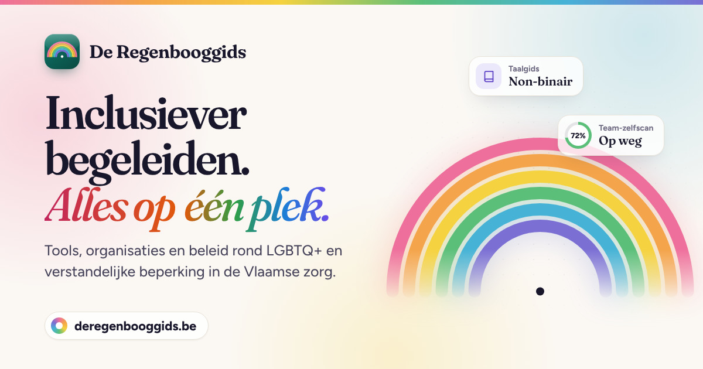
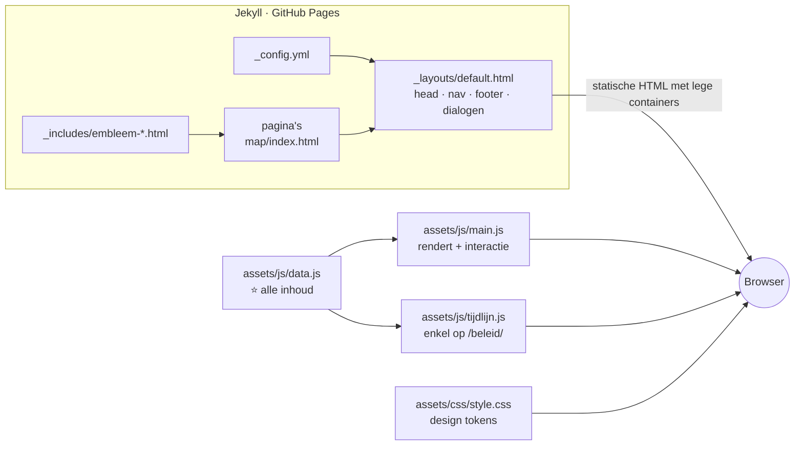

<div align="center">

<a href="https://deregenbooggids.be"></a>

# De Regenbooggids

**Inclusiever begeleiden. Alles op één plek.**

Een praktische hub voor begeleiders en organisaties in de Vlaamse zorg, rond LGBTQ+ en genderdiversiteit<br>bij cliënten met een verstandelijke beperking.

[](https://deregenbooggids.be)
[](https://github.com/kobec00/DeRegenboogGids/commits/main)
[](https://pages.github.com)
[](#-hoe-het-werkt)

[](#-privacy--opslag)

[**🌐 Bekijk de site**](https://deregenbooggids.be) &nbsp;·&nbsp;
[🧭 Wegwijzer](https://deregenbooggids.be/wegwijzer/) &nbsp;·&nbsp;
[📚 Bronnen](https://deregenbooggids.be/bronnen/) &nbsp;·&nbsp;
[✉️ Contact](https://deregenbooggids.be/over/#contact)

</div>

---

## Inhoud

- [✨ Wat is De Regenbooggids?](#-wat-is-de-regenbooggids)
- [📄 De pagina's](#-de-paginas)
- [🧱 Hoe het werkt](#-hoe-het-werkt)
- [📁 Projectstructuur](#-projectstructuur)
- [📝 Inhoud toevoegen of aanpassen](#-inhoud-toevoegen-of-aanpassen)
- [🎨 Design system](#-design-system)
- [♿ Toegankelijkheid](#-toegankelijkheid)
- [🔒 Privacy & opslag](#-privacy--opslag)
- [💻 Lokaal draaien & publiceren](#-lokaal-draaien--publiceren)
- [🤝 Bijdragen](#-bijdragen)
- [👤 Over het project](#-over-het-project)

---

## ✨ Wat is De Regenbooggids?

Tools, methodieken en contactorganisaties rond LGBTQ+ en verstandelijke beperking bestaan wel, maar ze staan verspreid over tientallen websites. Voor een drukke begeleider, of een team dat net wil starten met inclusiebeleid, is dat een drempel. De Regenbooggids brengt alles samen op één doorzoekbare plek: **minder zoeken, meer doen.**

De site is het praktijkproduct bij een graduaatsproef (Graduaat Orthopedagogische Begeleiding, UCLL Sociale School Heverlee, 2025–2026) met als onderzoeksvraag:

> *Hoe gaan residentiële zorgsettings om met LGBTQ+ en genderdiversiteit bij cliënten met een licht verstandelijke beperking, en welke ondersteuning kan bijdragen aan een inclusieve begeleiding?*

**Voor wie?** Begeleiders, teams en organisaties in de Vlaamse zorg, en (via toegankelijke tools in eenvoudige taal) ook cliënten zelf.

<sub>📊 Stand oktober 2026: 15 tools · 21 organisaties · 34 begrippen · 10 casussen · 16 beleidskaders · 30 items op de tijdlijn. De site telt zelf live mee uit <code>data.js</code>.</sub>

---

## 📄 De pagina's

| | Pagina | URL | Wat vind je er? |
|:-:|---|---|---|
| 🏠 | **Home** | [`/`](https://deregenbooggids.be/) | Hero met geanimeerde regenboog, live tellers, ingangen naar elk onderdeel, taalkaarten om te draaien, een strook mijlpalen en de hulplijnen. |
| 🧭 | **Wegwijzer** | [`/wegwijzer/`](https://deregenbooggids.be/wegwijzer/) | Keuzehulp: twee of drie vragen (voor wie, welk thema, eventueel welke situatie of regio) → een selectie op maat uit de praktijkinstrumenten, casussen, tools en organisaties, telkens met de reden erbij. |
| 🛠️ | **Tools** | [`/tools/`](https://deregenbooggids.be/tools/) | Werkboeken, methodieken en websites, te filteren op thema en doelgroep. Nederlands materiaal krijgt het label *Uit Nederland*. |
| 👥 | **Organisaties** | [`/organisaties/`](https://deregenbooggids.be/organisaties/) | Verenigingen, steunpunten en infolijnen, te filteren op regio en type. Werkingen die mogelijk niet meer actief zijn, staan apart onderaan. |
| 💡 | **Praktijk** | [`/praktijk/`](https://deregenbooggids.be/praktijk/) | Vijf instrumenten in tabbladen: **Casuïstiek** · **Taalgids** (naslaan of oefenen met leerkaarten) · **Vlaggensysteem in het kort** · **Team-zelfscan** (met radardiagram) · **Test jezelf**. |
| ⚖️ | **Beleid** | [`/beleid/`](https://deregenbooggids.be/beleid/) | Wetgeving, Vlaams zorgbeleid, wetenschappelijke onderbouwing en vorming. Waar meld je discriminatie (VMRI, Unia, IGVM)? Plus de **mijlpalen-tijdlijn** in drie fases, van 1897 tot de open dossiers van vandaag. |
| 📚 | **Bronnen** | [`/bronnen/`](https://deregenbooggids.be/bronnen/) | Alle bronnen in APA 7: de graduaatsproef, vakliteratuur, wetgeving en webbronnen. |
| ℹ️ | **Over** | [`/over/`](https://deregenbooggids.be/over/) | Achtergrond, selectiecriteria (wat staat erin en wat niet), privacy, contact en een oproep aan ervaringsdeskundigen in eenvoudige taal. |

**Overal beschikbaar:** zoeken over de hele site met <kbd>Ctrl</kbd> <kbd>K</kbd> / <kbd>⌘</kbd> <kbd>K</kbd> · de knop *Hulp nodig?* met crisis- en hulplijnen · weergave licht / donker / automatisch · een toegankelijke modus · een doneer-overzicht · printvriendelijke opmaak.

---

## 🧱 Hoe het werkt

Een statische site op **GitHub Pages**. Jekyll doet enkel het skelet (layout, includes, config). Alle inhoud staat als data in één JavaScript-bestand, en `main.js` bouwt daar in de browser de pagina's mee op.



**De principes in het kort:**

- **Geen framework, geen npm, geen build-stap.** Gewone HTML, CSS en JavaScript. Wat je in de repo ziet, is wat de browser krijgt.
- **Inhoud ≠ code.** De HTML-pagina's bevatten vooral lege containers (`#tools-list`, `#casus-view`, `#tl` …). `main.js` vult ze op basis van `data.js`. Een tool of begrip toevoegen raakt dus geen HTML aan.
- **Modules falen apart.** `start()` roept elke `init…()` op via `stap()`, met een eigen `try/catch`. Een init doet niets als zijn container niet op de pagina staat, dus één script dient alle pagina's.
- **Eén klik-handler.** Knoppen krijgen `data-action="…"` en verwijzen naar de `ACT`-map in `main.js`. Daarnaast bestaan `data-go` (naar een instrument, casus of pagina), `data-theme-set` en `data-fun`.
- **Tellers vullen zichzelf.** `<dd data-count="TOOLS">15</dd>` wordt automatisch de lengte van `TOOLS`. Het getal in de HTML is enkel een terugval zonder JavaScript.
- **Toestand in de URL, dus deelbaar.** Filters (`/tools/?thema=gen&doelgroep=begeleider`), het praktijk-tabblad (`/praktijk/?tab=taal`), de Wegwijzer (`/wegwijzer/?wie=team&wat=gender`) en de tijdlijn (`/beleid/#tijdlijn-1973`, `#tijdlijn-fase-2`). De terugknop van de browser werkt gewoon.
- **Zoekindex uit de data.** De zoekfunctie (<kbd>Ctrl</kbd> <kbd>K</kbd>) bouwt bij het eerste gebruik haar index uit alle collecties in `data.js`. Nieuwe inhoud is dus meteen vindbaar.
- **Progressive enhancement.** Elke pagina heeft een `<noscript>`-terugval met de belangrijkste links of het nummer van een infolijn.

<details>
<summary><b>🔍 De opbouw van <code>main.js</code> (12 secties)</b></summary>

<br>

| # | Sectie | Wat gebeurt er? |
|:-:|---|---|
| 1 | Hulpjes | `$`, `$$`, `ico()`, `esc()`, `slug()`, `norm()` en de kleur- en icoontabellen |
| 2 | Weergave | Licht / donker / auto en de toegankelijke modus, bewaard in `localStorage` |
| 3 | Navigatie | Sticky menu, mobiel menu (popover) |
| 4 | Dialogen | Hulplijnen, fun facts, doneren |
| 5 | Zoeken | Command palette met <kbd>Ctrl</kbd> <kbd>K</kbd>, index uit `data.js`, toetsenbordnavigatie |
| 6 | Onthullen & tellers | Scroll-animaties en optellende cijfers |
| 7 | Home | Hero, marquee, bento-raster, taalkaarten, mijlpalen-strook |
| 8 | Kaarten & filters | `maakFilter()`: herbruikbare filterlijst (zoekveld + chips + live aantallen + URL-sync) voor tools, organisaties en de taalgids |
| 9 | Praktijk | Tabbladen, casuïstiek, taalgids met oefenmodus, Vlaggensysteem, team-zelfscan, test jezelf |
| 10 | Wegwijzer | Vragenflow, scoring per item, resultaat met uitleg, toestand in de URL |
| 11 | Over | Het merkteken dat meekantelt met de cursor |
| 12 | Acties & start | De `ACT`-map, de gedelegeerde klik-handler en `start()` |

`tijdlijn.js` staat apart en wordt enkel geladen op pagina's met `tijdlijn: true` in de front matter (vandaag alleen `/beleid/`).

</details>

---

## 📁 Projectstructuur

```text
.
├── _config.yml              # titel, url, 'laatst_bijgewerkt', jekyll-sitemap
├── _layouts/
│   └── default.html         # <head> + SEO/Open Graph/JSON-LD, iconensprite, nav, footer, dialogen, scripts
├── _includes/
│   └── embleem-*.html       # decoratieve SVG-emblemen in de paginakoppen
│
├── index.html               # home
├── wegwijzer/index.html     # één map per pagina → nette URL's (/wegwijzer/)
├── tools/index.html
├── organisaties/index.html
├── praktijk/index.html
├── beleid/index.html        # front matter 'tijdlijn: true' laadt de tijdlijn
├── bronnen/index.html
├── over/index.html
├── 404.html
│
├── assets/
│   ├── css/
│   │   ├── style.css        # design system: tokens, componenten, donker, toegankelijk, print
│   │   └── tijdlijn.css     # enkel op /beleid/
│   └── js/
│       ├── data.js          # ⭐ ALLE INHOUD: tools, organisaties, begrippen, casussen, tijdlijn …
│       ├── main.js          # rendert de pagina's + alle interactie
│       └── tijdlijn.js      # mijlpalen-tijdlijn
│
├── favicon.ico · favicon.svg · apple-touch-icon.png
├── og-image.jpg             # 1200×630 preview voor sociale media
├── CNAME                    # eigen domein: deregenbooggids.be
└── Gemfile · Gemfile.lock   # github-pages gem, voor lokaal bouwen
```

**Front matter van een pagina:**

```yaml
---
layout: default
title: "Tools & methodieken — De Regenbooggids"   # <title> en social preview
description: "…"                                    # meta description en social preview
permalink: /tools/
bodyclass: page-tools                               # class op <body>, voor paginaspecifieke CSS
tijdlijn: true                                      # optioneel: laadt tijdlijn.css + tijdlijn.js
sitemap: false                                      # optioneel: niet in sitemap.xml (bvb. 404)
---
```

---

## 📝 Inhoud toevoegen of aanpassen

> [!TIP]
> Bijna alles wat je op de site leest, staat in **[`assets/js/data.js`](assets/js/data.js)**. Een tool, organisatie, begrip, casus of mijlpaal toevoegen? Dan pas je enkel dat bestand aan. Tellers, filters, zoekfunctie en Wegwijzer volgen vanzelf.

| Constante | Wat zit erin? | Waar zie je het? |
|---|---|---|
| `TOOLS` | Tools en methodieken | `/tools/`, Wegwijzer, zoeken, home |
| `ORGS` | Organisaties en contacten | `/organisaties/`, Wegwijzer, zoeken, home |
| `ORGS_INACTIEF` | Werkingen die mogelijk niet meer actief zijn | Enkel onderaan `/organisaties/`, telt nergens mee |
| `BELEID` · `BELEID_GROEPEN` | Beleids- en vormingskaders, in vier groepen | `/beleid/`, zoeken |
| `MELDPUNTEN` | Waar meld je discriminatie? | `/beleid/#melden` |
| `HULPLIJNEN` | Crisis- en hulplijnen | Knop *Hulp nodig?*, home |
| `WW_STAPPEN` · `WW_PRAKTIJK` · `WW_TERMEN` | Vragen en keuzes van de Wegwijzer | `/wegwijzer/` |
| `CASUS` | Situaties uit de leefgroep met handvatten | Praktijk → Casuïstiek |
| `TERMEN` · `TERM_CATS` | Begrippen voor de taalgids | Praktijk → Taalgids, taalkaarten op home |
| `SCAN_VRAGEN` · `SCAN_DOMEIN_ADVIES` · `SCAN_BRONNEN` | Stellingen, advies en links van de team-zelfscan | Praktijk → Team-zelfscan |
| `VLAG_CRITERIA` · `VLAGGEN` · `VLAG_STAPPEN` | Het Vlaggensysteem in het kort (naar Sensoa) | Praktijk → Vlaggensysteem |
| `QUIZ_VRAGEN` | Vragen van de zelftest | Praktijk → Test jezelf |
| `TL_FASES` · `TIJDLIJN` · `TL_BRON` | Fases, mijlpalen, open dossiers en hun bronnen | `/beleid/#tijdlijn`, strook op home |

<details>
<summary><b>➕ Voorbeeld: een tool toevoegen</b></summary>

<br>

```js
{ title:"Naam van de tool", org:"Organisatie", thema:"Gender & Trans", doelgroep:"Begeleiders",
  beschrijving:"Eén of twee zinnen over wat het is en voor wie.",
  url:"https://…", ww:["gender","taal"] },
```

- **`thema`**: `Seksualiteit & Identiteit` · `Gender & Trans` · `Beleid & Organisatie`
- **`doelgroep`**: `Cliënten` · `Begeleiders` · `Cliënten & Begeleiders` · `Organisaties`
- **`ww`**: de thema's voor de Wegwijzer; het eerste is het hoofdthema. Mogelijke waarden: `relaties` · `grenzen` · `gender` · `comingout` · `taal` · `werking` · `doorverwijzen`
- **`land:"NL"`** (optioneel): toont het label *Uit Nederland*

</details>

<details>
<summary><b>➕ Voorbeeld: een organisatie toevoegen</b></summary>

<br>

```js
{ naam:"Naam vzw", regio:"Heel Vlaanderen", type:"Info & Ondersteuning",
  beschrijving:"Wat doet de organisatie, en voor wie?",
  url:"https://…", telefoon:"0800 00 000", ww:["comingout","doorverwijzen"] },
```

- **`regio`**: `Heel Vlaanderen` · `Antwerpen` · `Gent (Oost-Vlaanderen)` · `Leuven (Vlaams-Brabant)` · `West-Vlaanderen` · `Limburg` · `Brussel` (de lijst komt uit de regio-vraag in `WW_STAPPEN`)
- **`type`**: `Begeleiding & Advies` · `Info & Ondersteuning` · `Ontmoeting & Activiteiten` · `Anonieme steun`
- **`telefoon`**: `null` als er geen infolijn is

</details>

<details>
<summary><b>➕ Voorbeeld: een begrip, casus of mijlpaal toevoegen</b></summary>

<br>

**Begrip** (taalgids):

```js
{ woord:"Non-binair", cat:"Gender", def:"Uitleg in toegankelijke taal.",
  tip:"Optionele tip of beter alternatief.", tipType:"fun" },   // tipType "fun" = knop 'Fun fact'
```

`cat` is een van `Algemeen` · `Oriëntatie` · `Gender` · `Liever vermijden`.

**Casus:**

```js
{ thema:"Identiteit", ww:["gender"], tag:"Gender & identiteit",
  titel:"Een korte, herkenbare situatie.",
  blokken:[ { kop:"Wat speelt er?", tekst:"…" }, { kop:"Wat kan je doen?", tekst:"…" } ],
  chips:[ { l:"Transgender Infopunt", url:"https://www.transgenderinfo.be" },   // externe link
          { l:"Naar de taalgids", go:"taal" } ] },                              // interne sprong
```

**Mijlpaal** (tijdlijn):

```js
{ fase:2, jaar:"2003", cat:"law", titel:"Openstelling van het huwelijk in België",
  desc:"Wat er gebeurde en waarom het ertoe doet.", bron:TL_BRON.vrt23 },
```

- **`cat`**: `science` · `move` · `law` · `beperking` · `weetje` (een weetje is geen mijlpaal)
- **`jaar2`**: optioneel tweede jaartal · **`id`**: eigen deeplink (`#tijdlijn-<id>`)
- **`type:"dossier"`**: een open dossier in fase 3, met `sinds` en `kort` in plaats van `jaar`
- Een nieuwe bron? Voeg ze toe aan `TL_BRON` én aan [`/bronnen/`](bronnen/index.html).

</details>

**Checklist na een inhoudelijke update:**

- [ ] Datum aanpassen in `_config.yml` → `laatst_bijgewerkt`. Die ene waarde verschijnt in de footer, op `/over/` en op `/bronnen/`.
- [ ] Een bron met auteur en jaartal? Zet ze ook in APA 7 op `/bronnen/`.
- [ ] Werkt de link nog, en is de organisatie nog actief? (zie de [selectiecriteria](https://deregenbooggids.be/over/#selectie))
- [ ] Optioneel: de terugvalgetallen in `index.html` (`data-count`) gelijkzetten voor wie zonder JavaScript surft.

---

## 🎨 Design system

*Eén boog, zes kleuren.* Alle kleuren, letters en maten zijn **CSS custom properties** in `:root` (`style.css`, sectie 1). De donkere modus (`html.dark`) en de toegankelijke modus (`html.a11y`) herdefiniëren vooral die tokens, zodat componenten zelf geen aparte varianten nodig hebben.

**Het palet** (de zes banden van de boog, plus de merkkleur):


&nbsp;


| Lettertype | Gebruik |
|---|---|
| **Fraunces** | Titels, met de cursieve *accenten* |
| **Figtree** | Lopende tekst en interface |
| **Atkinson Hyperlegible** | Alles in de toegankelijke modus, en de oproep in eenvoudige taal op `/over/` |

- **Tonen:** componenten krijgen een kleur via `tone-teal` · `tone-violet` · `tone-amber` · `tone-rose` · `tone-blue` · `tone-slate`.
- **Iconen:** één SVG-sprite bovenaan `default.html`. In HTML: `<svg class="i"><use href="#i-search"/></svg>`, in JavaScript: `ico('search')`.
- **`style.css` in 15 secties:** tokens · basis · bouwstenen · navigatie · footer · hulp & dialogen · home · subpagina's · praktijk · wegwijzer · over · donker · toegankelijk · beweging · print.

---

## ♿ Toegankelijkheid

Toegankelijkheid is geen extraatje voor een gids over mensen met een beperking. Wat erin zit:

- **Toegankelijke modus:** hoog contrast, grotere en beter leesbare letters, geen animaties. Aan te zetten via *Weergave* of in de footer.
- **Minder beweging:** `prefers-reduced-motion` wordt gerespecteerd (in JS via `calm()`).
- **Toetsenbord:** skip-link naar de inhoud, zichtbare focus, tabbladen met pijltjestoetsen, <kbd>Ctrl</kbd> <kbd>K</kbd> om te zoeken, <kbd>Esc</kbd> om te sluiten.
- **Schermlezers:** ARIA-rollen voor tabs, dialogen en de zoeklijst, `aria-live` bij tellers en resultaten, en *"(opent in nieuw tabblad)"* bij externe links.
- **Geen lichte flits:** het gekozen thema wordt hersteld vóór de eerste render.
- **Print:** casussen, het resultaat van de zelfscan en de Wegwijzer zijn netjes af te drukken of op te slaan als PDF.

---

## 🔒 Privacy & opslag

- **Statistieken:** anonieme bezoekersaantallen via [Umami](https://umami.is). Geen cookies, geen persoonsgegevens, geen tracking over websites heen.
- **Lettertypes:** geladen via Google Fonts.
- **Lokale opslag:** enkel op het toestel van de bezoeker, nooit verstuurd:

| Sleutel | Waarvoor? |
|---|---|
| `rg-modus` | Gekozen weergave: `light`, `dark` of `a11y` (leeg = volg het toestel) |
| `rg-scan` | Antwoorden van de team-zelfscan, om later verder te gaan |
| `rg-scan-hist` | De laatste resultaten van de zelfscan, om te vergelijken |
| `rg-quiz-best` | Beste score op *Test jezelf* |

Alle toegang tot `localStorage` zit in een `try/catch`, zodat de site ook in een privévenster gewoon werkt.

---

## 💻 Lokaal draaien & publiceren

**Vereisten:** Ruby 3.x en Bundler.

```bash
git clone https://github.com/kobec00/DeRegenboogGids.git
cd DeRegenboogGids
bundle install
bundle exec jekyll serve
# → http://localhost:4000
```

> [!NOTE]
> Krijg je een Sass-fout als `Invalid US-ASCII character`? Zet dan je locale op UTF-8: `LANG=C.UTF-8 bundle exec jekyll serve`.

**Publiceren:** elke push naar `main` wordt automatisch gebouwd en gepubliceerd door GitHub Pages op [deregenbooggids.be](https://deregenbooggids.be) (eigen domein via `CNAME`). `sitemap.xml` en `robots.txt` maakt `jekyll-sitemap` vanzelf aan.

---

## 🤝 Bijdragen

Het overzicht is bewust nooit af: het werkveld verandert snel. Ken je een tool, organisatie of good practice die hier thuishoort, of klopt er iets niet meer?

- 🐛 Open een [issue](https://github.com/kobec00/DeRegenboogGids/issues), of
- ✉️ mail naar [kobe.cornelis4@gmail.com](mailto:kobe.cornelis4@gmail.com).

Wat wel en niet in de gids komt, staat in de [selectiecriteria](https://deregenbooggids.be/over/#selectie): materiaal op het kruispunt van LGBTQ+ en beperking, Vlaams waar het kan, met een betrouwbare afzender, bruikbaar in de praktijk en actueel. Geen commercieel aanbod.

**Code:** werk op een aparte branch, test lokaal met `jekyll serve` (ook in donkere en toegankelijke modus, en op gsm-breedte) en open een pull request naar `main`.

---

## 👤 Over het project

**Kobe Cornelis** · student bachelor Orthopedagogie en begeleider<br>
Graduaatsproef Graduaat Orthopedagogische Begeleiding, **UCLL Sociale School Heverlee**, 2025–2026<br>
Eindwerkbegeleider: Elke Van Nooten

[🌐 kobecornelis.com](https://kobecornelis.com) · [💼 LinkedIn](https://www.linkedin.com/in/kobecornelis/) · [✉️ Mail](mailto:kobe.cornelis4@gmail.com)

> [!IMPORTANT]
> De Regenbooggids is niet commercieel en verzamelt bestaande bronnen. Gelinkte tools, methodieken en teksten blijven eigendom van hun makers. Het Vlaggensysteem is bijvoorbeeld van [Sensoa](https://www.sensoa.be). Controleer actuele info altijd bij de bron.
>
> Voor de code en eigen teksten in deze repo is (nog) geen licentie toegevoegd. Standaard blijven dus alle rechten voorbehouden.

<details>
<summary>🇬🇧 <b>In English</b></summary>

<br>

**De Regenbooggids** ("The Rainbow Guide") is a Dutch-language resource hub for care professionals in Flanders (Belgium) working with LGBTQ+ clients who have an intellectual disability. It brings tools, organisations, policy, a glossary, case studies, a team self-assessment and a timeline of rights together in one searchable place. It was built as the practical outcome of a graduate thesis at UCLL.

Technically, it is a static Jekyll site on GitHub Pages with no framework and no build step: all content lives in `assets/js/data.js`, and `assets/js/main.js` renders it client-side.

</details>

<div align="center">
<br>
<sub>Gemaakt met 🌈 in Vlaanderen</sub>
</div>
